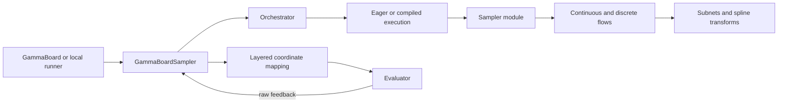

# Architecture

The sampler separates public process integration from proposal modeling and
training orchestration. Configuration reference is maintained separately under
[configuration](../configuration/README.md).

## Responsibilities and source

| Component | Owns | Source |
| --- | --- | --- |
| Public adapter | Domain adaptation, singleton masking, hidden mapping channels, mapping corrections, public densities, lifecycle delegation | [gammaboard_sampler.py](../../src/gammaboard_sampler.py) |
| Orchestrator | Generation windows, training buffers, optimizer, loss, scheduler, device/precision, proposal checkpoints | [orchestrator.py](../../src/glnis/core/nn/orchestrator.py) |
| Proposal execution | Runtime `sample`/`prob` callables and compiler settings, outside serialized model state | [execution.py](../../src/glnis/core/nn/execution.py) |
| Proposal module | Joint sampling and probabilities, tensor layout, discrete masses | [sampler_module.py](../../src/glnis/core/nn/sampler_module.py) |
| Flow components | Conditional probability factorization and learned coordinate transforms | [flow/](../../src/glnis/core/nn/flow/) |
| Coordinate mapping | Geometry, Jacobians, separately exposed integration corrections | [mappings.py](../../src/glnis/core/mappings.py) |
| Metadata parser | Explicit or GammaLoop-derived graph properties | [parser.py](../../src/glnis/core/parser.py) |
| Local execution | Configuration loading, concurrent evaluation, ordered feedback, statistics and histories | [config.py](../../src/glnis/core/config.py), [sampler_aggregator.py](../../src/glnis/core/sampler_aggregator.py) |

The neural proposal uses PyTorch; public coordinates, mapping calculations, and
process feedback use NumPy. Numerical integrands evaluate raw values and do not
own proposal probabilities or graph-dependent coordinate mappings.

`BuildFromKind` discovers imported implementation classes. It is used for
orchestrators, execution policies, modules, flows, subnets, splines, losses, schedulers, and mapping
layers. Local integrands currently have a separate explicit factory registry.

## Generation and evaluation

The orchestrator draws internal coordinates and computes their joint probability.
The adapter restores singleton axes and maps continuous coordinates. Hidden
mapping-channel axes are consumed before returning the public batch. The
[Jacobian and integration correction](mappings.md) modify its weights.

GammaBoard owns process evaluation and supplies raw masked feedback. For local
runs, `SamplerAggregator` owns evaluator threads, restores training sample order,
and projects complex values according to its configured training phase. The
adapter then applies mapping corrections and forwards feedback to the orchestrator.

## Current scope

The default adapter requires a rectangular shape. The default orchestrator owns
one proposal module with one Adam optimizer and training state. A duplicated
module-per-stratum orchestrator is an extension point, not an existing built-in
implementation. Retired sign-strategy classes are unavailable.

Core imports and explicit graph mappings work without GammaLoop. Reading a
GammaLoop state uses the optional [native companion](../../native/gammaloop/)
and symbolic dependencies through lazy loading in
[_optional.py](../../src/glnis/_optional.py). Multiple parsed graph groups are not
automatically composed by the current layer stack.

For changes, begin with the relevant contract:
[sampling](sampling-and-feedback.md), [mappings](mappings.md),
[persistence](checkpoints-and-stages.md), or [extension interfaces](extending.md).
